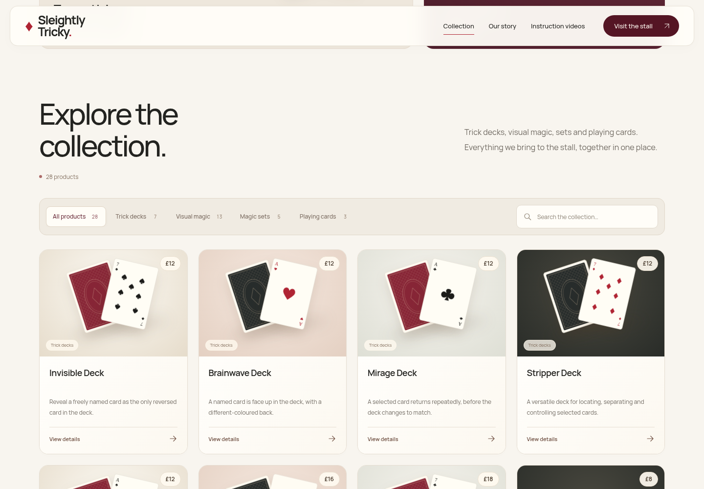

# Sleightly Tricky website

PHP website for Sleightly Tricky, including its stallholder editor and
password-protected customer instruction videos. This project is independent
of MediaHub; the GitHub organisation name is just where it is stored.

## The 1.9.1 admin layout update

The admin now fills the browser width instead of sitting inside a centred fixed
maximum width. A narrower sidebar, shorter header and tighter spacing leave more
room for editing. The instruction editor groups Page details, Video & notes and
Customer access into columns when the panel has room, and stacks them on smaller
screens. Its Save/Delete toolbar stays visible while scrolling. Product pickers
scroll within their panels; website publication controls align with the workspace.
All six tabs are checked at widths from 320 to 2560 pixels, including the sticky
instruction Save control. Saved content, passwords and videos are unchanged.

## The 1.9 instruction access update

Shared trick passwords accept any combination of uppercase and lowercase letters.
A signed, HttpOnly cookie remembers each trick for a fixed 15 minutes after unlock,
including refreshes and return visits. Refreshing does not extend the timer. The
manual Lock this page button is removed. After expiry, the next page or private
video request needs the password again. Stallholder login passwords remain exact.

When upgrading, keep the existing private folder. In **Admin → Instruction
videos**, re-enter each existing printed password once and save to enable all
letter cases immediately. Old one-way hashes cannot be converted without the
password. Original-case successful unlocks also upgrade old passwords automatically;
passwords previously stored entirely lowercase can upgrade from any letter case.
The editor identifies pages still needing this one-time update. No plaintext
passwords are stored. Changing a password revokes its existing access cookies.

## The 1.8 linked instruction pages

In **Admin → Instruction videos**, select a **Linked collection product** and
save the instruction page. Its library card and password screen now share the
product’s collection photo or artwork. Publish a replacement product photo in
Collection and the linked instruction pages follow automatically; no second
upload is needed. The editor previews the shared photo. New pages can also take
their initial title and address from the selected product.

Product links are optional. Existing pages keep their titles, addresses, videos,
passwords and publication settings until edited. The private database gains one
optional field automatically; keep your existing private folder when upgrading.
Hiding a product leaves the lesson’s own publication setting in control. Removing
a product falls back to the standard instruction artwork, and the lesson can
still be edited, relinked or unlinked. Publish new collection products before
selecting them in the instruction editor.

[Linked instruction editor](docs/redesign/admin-instruction-product.png) ·
[Shared instruction artwork](docs/redesign/instruction-library.png) ·
[Linked password page](docs/redesign/instruction-product-gate.png).

## The 1.7 combined collection

One catalogue now holds trick decks, visual magic, magic sets and playing cards.
The separate playing-card section is gone. Optional type filters and search work
together, with live result counts and product details that browse the currently
visible results. All products remain readable without JavaScript.

The catalogue contains the 28 products from the supplied Price List.docx:
7 trick decks, 13 visual tricks, 5 sets and 3 playing-card ranges. The five grouped
Sleightly Tricky trick decks are separate £12 products; the nine grouped visual
tricks are separate £8 products. [Full product and price list](docs/catalogue-price-list.md).

Existing installations apply the list on the first load after upgrading. Matching
products keep their IDs, uploaded photos, custom descriptions and visibility;
listed names, prices and product types update to the supplied list. New entries
are added. Previous stock items omitted from the list stay in the admin as hidden
products, and unlisted card editions are hidden in favour of the three card ranges.
Other custom products keep their settings. Common name variations, including Colouring /
Coloring Book and products already added under custom IDs, are matched.

Open the admin, review the collection and **Publish changes** once to store the
updated catalogue. After that, later edits, hiding, removal and price changes
remain authoritative; the price list is not reapplied. Existing accounts,
instruction passwords/videos, uploaded files and custom page content remain in
the existing private folder. The supplied private-folder backup was checked
locally; it is never included in this repository or deployment archive.

The accepted burgundy/cream visual style, artwork and motion remain. The catalogue
uses one four-column desktop grid (two columns on phones), smaller product scenes,
a shared search/filter bar and matching admin product types. No application
upload-size or image-dimension caps have been reintroduced.

[](docs/redesign/homepage-full.png)

[Full homepage](docs/redesign/homepage-full.png) ·
[Mobile collection](docs/redesign/collection-mobile.png) ·
[Product details](docs/redesign/product-details.png) ·
[Instruction library](docs/redesign/instruction-library.png).


The admin portal now uses the same Manrope typography, rich burgundy navigation,
cream surfaces and card artwork. It includes a live opening-section preview,
searchable product picker, responsive navigation, grouped lesson settings and a
sticky publication bar. Website publication controls appear only for text,
collection and photos; instruction pages keep their own Save action. Tab navigation
works with arrow keys and Home/End, and Ctrl/Cmd+S saves the active content editor.

[Admin editor](docs/redesign/admin-website.png) ·
[Admin collection](docs/redesign/admin-collection.png) ·
[Instruction editor](docs/redesign/admin-instructions.png) ·
[Admin mobile](docs/redesign/admin-mobile.png) ·
[Stallholder sign-in](docs/redesign/admin-login.png).

The cup artwork retains the three correctly inverted cups. Faces are drawn
as exact SVGs with black spades/clubs, red hearts/diamonds, matching opposing
indices and correct pip counts. Generic card backs and prop illustrations
are unbranded; actual uploaded product photos take priority. The new tabletop
still life shows only face-down cards. These images are illustrative, not
photographs of the products for sale. Screenshots use sample instruction pages;
no demo passwords, customer pages or private videos are included in the ZIP.

Unchanged stock headings are refreshed for the combined collection. Custom page
copy, photos and instruction settings are preserved. The existing magicTitle /
magicIntro fields now control the collection heading and introduction; old
cardsTitle / cardsIntro values are retained for compatibility but are not displayed.

## Download and install

Download [the Plesk deployment ZIP](releases/sleightly-tricky-website.zip).
Follow [INSTALL-PLESK.txt](INSTALL-PLESK.txt). Extract the deployment ZIP one
level above `httpdocs`, or upload only its `httpdocs` contents to your public
root. Preserve existing private data when upgrading.

The ZIP has no preconfigured accounts, customer passwords or videos. Create
your owner account using the unique code generated outside the public root,
then add your tricks through **Admin → Instruction videos**.

Each page supports a shared trick password, public summary, protected notes,
one YouTube/Vimeo/direct MP4 video or private MP4 upload, a customer link,
publish/hide, and delete. Instruction changes use their own Save button.
**Private video uploads have no application file-size cap.** PHP, web-server,
timeout and storage limits still apply; configure those in Plesk for your files.
Image uploads also have no application file-size or dimension cap.
External providers still control access to their video URLs; private uploads
are checked by the website on every request. Shared passwords do not provide
DRM or prevent buyers sharing access.

## Local development

Requires PHP 8.2+ with PDO SQLite and fileinfo. There are no Composer or npm
dependencies. Use the existing checkout: cloud tasks are already isolated;
do not create a Git worktree unless explicitly requested.

On a PHP-equipped machine, from the repository root:

```sh
ST_LOCAL_HTTP=1 ST_STORAGE_DIR=/tmp/sleightly-dev-data \
  php -d upload_max_filesize=2G -d post_max_size=0 \
  -S 127.0.0.1:8081 -t . tools/dev-router.php
```

The example allows 2 GiB per file locally and no total POST size cap; choose
limits appropriate for your machine. The website itself imposes no video size cap.
The HTTP override is accepted only by PHP's built-in development server.
Production always requires HTTPS with the supplied configuration. Never run
PHP's development server as your production web server. Local private data
must be outside the checkout/public root. The development router also blocks
source/configuration files normally protected by Apache's `.htaccess`.

For this Debian cloud environment, `sh tools/cloud-install.sh` prepares a
user-local PHP runtime at `/workspace/.runtime/bin/php` without root access.
Use that path in place of `php` in the commands above.

## Validation

```sh
PHP_BIN=/workspace/.runtime/bin/php python3 -m unittest discover -s tests -v
PHP_BIN=/workspace/.runtime/bin/php python3 tests/browser_smoke.py
PHP_BIN=/workspace/.runtime/bin/php python3 tests/design_smoke.py
PHP_BIN=/workspace/.runtime/bin/php python3 tests/admin_design_smoke.py
```

The automated suite has 24 passing tests covering original-site setup/migration,
editing, customer gates, CSRF, rate limiting, expiry, per-page access,
password replacement, hiding/deleting, private uploads and byte ranges,
malformed inputs, editor permissions and revocation, exact card pip counts/colours,
card indices, compatible copy upgrades and a real upload above the former
200 MB limit with protected streaming beyond that boundary. Image tests cover
files over the former 5 MB cap, widths/heights over 16,000 pixels, images over
60 megapixels, published product photos and invalid/unauthorised uploads.
Catalogue tests also check the supplied names and prices, grouped pricing, safe
upgrades, name matching, retained photos/IDs, and preservation of later admin
edits/removals. HTTP checks cover the first upgrade, publication, reload and
continued instruction access. Linked-page tests check the additive database
upgrade, matching collection artwork, photo changes, invalid product links,
legacy clients, hiding/removing products and unlinking. All automated tests use temporary data.
The browser smoke test requires Python Playwright and `/usr/bin/chromium`.
It exercises product-photo uploads above 5 MB, opening/banner uploads,
publishing/reloading, admin page creation, real video upload, saved-page reload,
mobile password entry and MP4 playback, password replacement, hiding,
deleting, responsive layout and JavaScript error checks.

The design smoke test checks five viewport widths (320–1440px), search,
password visibility, FAQs, keyboard/menu interactions, JavaScript-disabled
navigation and native form submission, reduced motion and horizontal overflow.
It also checks product dialogs, focus wrapping/return, combined type/search
filters, mobile product details, pointer-depth animation and cancellation when
the motion preference changes.

The portal smoke test checks live local previews versus published content,
keyboard publication, product search, navigation orientation, all six admin tabs
at five widths, mobile sign-out and reduced motion.

Real YouTube/Vimeo playback and production Plesk settings require validation
with your hosting account and actual video links. The test video is a tiny
blank clip, not a customer's instructions, and is excluded from deployment.

Build the deployment ZIP and checksums with `python3 tools/package.py`.
Run `PHP_BIN=/workspace/.runtime/bin/php python3 tools/verify-package.py` to
check explicit ZIP permissions, real unzip extraction, deployment layout,
and the HTTP suite against the extracted website. Public files are packaged
as `644` and directories as `755`, independently of local workspace modes.
The package includes only deployable site files and the Plesk guide; it
excludes Git metadata, development tools, tests, private data and credentials.

## Font licences

Libre Caslon Display and Manrope are self-hosted from the official Google Fonts
repository under the SIL Open Font License. Their licence notices are included
in [assets/fonts](assets/fonts). Site fonts and interface scripts are served locally. External video providers
load only after a customer unlocks a lesson.
