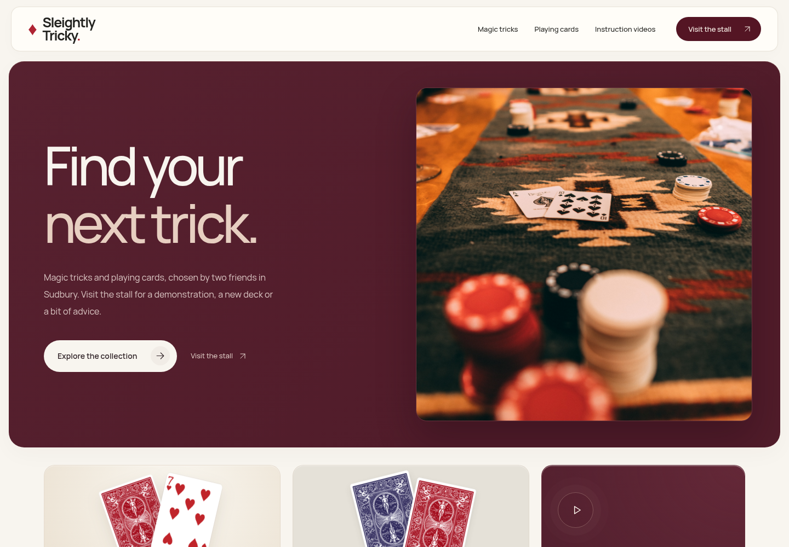
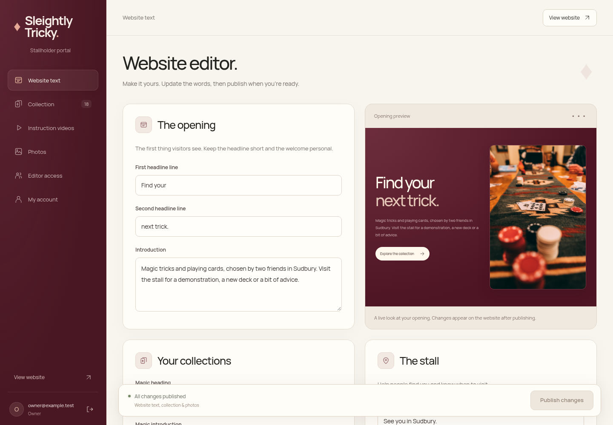

# Sleightly Tricky website

PHP website for Sleightly Tricky, including its stallholder editor and
password-protected customer instruction videos. This project is independent
of MediaHub; the GitHub organisation name is just where it is stored.

## The 1.6 artwork update

The burgundy, cream and charcoal design now uses established card artwork and
real photography. The generic card backs have been replaced with the familiar
Bicycle Rider Back design from xCards, accompanied by standard card faces.
The original SVGs, upstream attribution and LGPL/GPL licence texts ship with
both the source and the deployment ZIP. The red version is a CSS hue treatment
of the unchanged blue artwork; no generative image tool was used.

The generated cup/tabletop still lifes have been removed. The opening now uses
a real photograph by JT on Unsplash; it shows a card game, not our stall or
actual shop stock. The story section uses card artwork until the stallholders
add their own photograph through **Admin → Photos**. That photograph can be
published, replaced or reset to the card artwork. Existing uploaded images
always take priority. [Image credits](credits.php) lists the sources.

The layout, product dialogs, swipeable deck gallery and motion remain, with
quieter shadows and more natural card arrangements. Reduced-motion preferences
are respected, nothing advances automatically, and the public catalogue and
customer password forms remain usable without JavaScript.

[](docs/redesign/homepage-full.png)

[Full homepage](docs/redesign/homepage-full.png) ·
[Mobile](docs/redesign/mobile.png) ·
[Product details](docs/redesign/product-details.png) ·
[Instruction library](docs/redesign/instruction-library.png).



The admin portal now uses the same Manrope typography, rich burgundy navigation,
cream surfaces and card artwork. It includes a live opening-section preview,
searchable product picker, responsive navigation, grouped lesson settings and a
sticky publication bar. Website publication controls appear only for text,
collection and photos; instruction pages keep their own Save action. Tab navigation
works with arrow keys and Home/End, and Ctrl/Cmd+S saves the active content editor.

[Admin editor](docs/redesign/admin-website.png) ·
[Admin collection](docs/redesign/admin-collection.png) ·
[Instruction editor](docs/redesign/admin-instructions.png) ·
[Admin mobile](docs/redesign/admin-mobile.png) ·
[Photo editor](docs/redesign/admin-photos.png) ·
[Stallholder sign-in](docs/redesign/admin-login.png).

Product card artwork is illustrative; it is not a photograph of a specific
edition or its packaging. Upload your actual stock photographs in Collection
to show the correct editions, especially for character-themed decks. Generic
prop illustrations are deliberately simple. Screenshots use sample lessons;
no demo passwords, customer pages or private videos are included in the ZIP.

Existing accounts, products, prices and private videos remain compatible.
Unchanged stock copy is refreshed for the new design; custom copy, prices,
photos and product settings are preserved. Changes are reflected in the
editor and become stored content when you next publish. The old decorative
location-line and product-label settings are no longer displayed or edited.

## Download and install

Download [the Plesk deployment ZIP](releases/sleightly-tricky-website.zip).
Follow [INSTALL-PLESK.txt](INSTALL-PLESK.txt). Extract the deployment ZIP one
level above `httpdocs`, or upload only its `httpdocs` contents to your public
root. Preserve existing private data when upgrading.

The ZIP has no preconfigured accounts, customer passwords or videos. Create
your owner account using the unique code generated outside the public root,
then add your tricks through **Admin → Instruction videos**.

Each page supports a shared trick password, public summary, protected notes,
one YouTube/Vimeo/direct MP4 video or private MP4 upload, a customer link,
publish/hide, and delete. Instruction changes use their own Save button.
**Private video uploads have no application file-size cap.** PHP, web-server,
timeout and storage limits still apply; configure those in Plesk for your files.
Image uploads retain their 5 MB limit.
External providers still control access to their video URLs; private uploads
are checked by the website on every request. Shared passwords do not provide
DRM or prevent buyers sharing access.

## Local development

Requires PHP 8.2+ with PDO SQLite and fileinfo. There are no Composer or npm
dependencies. Use the existing checkout: cloud tasks are already isolated;
do not create a Git worktree unless explicitly requested.

On a PHP-equipped machine, from the repository root:

```sh
ST_LOCAL_HTTP=1 ST_STORAGE_DIR=/tmp/sleightly-dev-data \
  php -d upload_max_filesize=2G -d post_max_size=0 \
  -S 127.0.0.1:8081 -t . tools/dev-router.php
```

The example allows 2 GiB per file locally and no total POST size cap; choose
limits appropriate for your machine. The website itself imposes no video size cap.
The HTTP override is accepted only by PHP's built-in development server.
Production always requires HTTPS with the supplied configuration. Never run
PHP's development server as your production web server. Local private data
must be outside the checkout/public root. The development router also blocks
source/configuration files normally protected by Apache's `.htaccess`.

For this Debian cloud environment, `sh tools/cloud-install.sh` prepares a
user-local PHP runtime at `/workspace/.runtime/bin/php` without root access.
Use that path in place of `php` in the commands above.

## Validation

```sh
PHP_BIN=/workspace/.runtime/bin/php python3 -m unittest discover -s tests -v
PHP_BIN=/workspace/.runtime/bin/php python3 tests/browser_smoke.py
PHP_BIN=/workspace/.runtime/bin/php python3 tests/design_smoke.py
PHP_BIN=/workspace/.runtime/bin/php python3 tests/admin_design_smoke.py
```

The automated suite has 14 passing tests covering original-site setup/migration,
editing, customer gates, CSRF, rate limiting, expiry, per-page access,
password replacement, hiding/deleting, private uploads and byte ranges,
malformed inputs, editor permissions and revocation, exact card pip counts/colours,
licensed Rider Back integrity, compatible copy/image upgrades and a real upload above the former
200 MB limit with protected streaming beyond that boundary. It uses temporary data.
The browser smoke test requires Python Playwright and `/usr/bin/chromium`.
It exercises admin page creation, real video upload, saved-page reload,
mobile password entry and MP4 playback, password replacement, hiding,
deleting, responsive layout and JavaScript error checks.

The design smoke test checks five viewport widths (320–1440px), search,
password visibility, FAQs, keyboard/menu interactions, JavaScript-disabled
navigation and native form submission, reduced motion and horizontal overflow.
It also checks product dialogs, focus wrapping/return, gallery button and keyboard
controls, mobile product details, pointer-depth animation and cancellation when
the motion preference changes.

The portal smoke test checks live local previews versus published content,
keyboard publication, product search, navigation orientation, all six admin tabs
at five widths, mobile sign-out, story-photo upload/publication/reset and reduced motion.

Real YouTube/Vimeo playback and production Plesk settings require validation
with your hosting account and actual video links. The test video is a tiny
blank clip, not a customer's instructions, and is excluded from deployment.

Build the deployment ZIP and checksums with `python3 tools/package.py`.
Run `PHP_BIN=/workspace/.runtime/bin/php python3 tools/verify-package.py` to
check explicit ZIP permissions, real unzip extraction, deployment layout,
and the HTTP suite against the extracted website. Public files are packaged
as `644` and directories as `755`, independently of local workspace modes.
The package includes only deployable site files and the Plesk guide; it
excludes Git metadata, development tools, tests, private data and credentials.

## Font licences

Libre Caslon Display and Manrope are self-hosted from the official Google Fonts
repository under the SIL Open Font License. Their licence notices are included
in [assets/fonts](assets/fonts). Site fonts and interface scripts are served locally. External video providers
load only after a customer unlocks a lesson.
